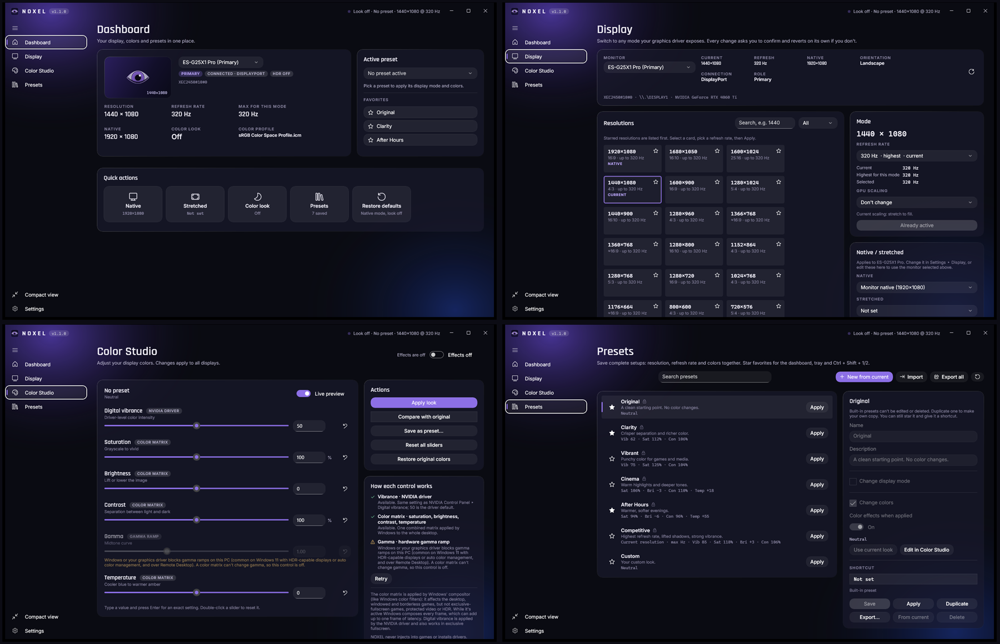

# NOXEL

NOXEL is a Windows 10/11 x64 display utility. Switch resolution and refresh rate, toggle native or stretched modes, and save display and color settings together in presets you can apply with hotkeys.

| Download | Choose this if |
| --- | --- |
| **[Windows installer](https://github.com/reprinted/NOXEL-Releases/releases/latest/download/NOXEL-Setup.exe)** | You want the recommended per-user installation. |
| [Portable executable](https://github.com/reprinted/NOXEL-Releases/releases/latest/download/NOXEL.exe) | You want to run NOXEL without installing it. |

[Release notes and checksums](https://github.com/reprinted/NOXEL-Releases/releases/latest) · [Compatibility](#compatibility)



NOXEL is licensed under the [GNU General Public License v3.0 only](LICENSE).

## Features

| Area | What it does |
|---|---|
| Dashboard | Live monitor data (name, resolution, exact refresh rate, max Hz, native mode, color profile, HDR), active preset, favorites, quick actions. |
| Display | Every driver-exposed mode per monitor, refresh-rate picker, favorites, custom-resolution lookup, native/stretched setup. Every change asks **Keep / Revert** and reverts by itself after 15 s; an interrupted change is rolled back on the next start. |
| Color Studio | Digital vibrance (NVIDIA driver), saturation, brightness, contrast, temperature (Windows color matrix), gamma (where Windows allows it). Live preview, compare, look codes. Unavailable controls are disabled with the reason. |
| Monitor Control | Enable or disable a monitor's device (as in Device Manager) and disconnect or reconnect a display from the desktop. Asks first, undoes itself after 15 s unless you keep the change, and never removes your last screen. |
| Presets | Display mode + colors in one profile, per monitor, with favorites, hotkeys, import/export and protected built-ins. |
| Shell | Global hotkeys (`RegisterHotKey`, no keyboard hooks), tray menu, compact always-on-top view, single instance, optional start with Windows. |
| Updates | Checks [NOXEL-Releases](https://github.com/reprinted/NOXEL-Releases) at start and daily (notify only by default). Installs only after size, SHA-256 and version checks, never during a pending display change. |

Privacy: no telemetry or accounts. Administrator approval is asked for only when you enable or disable a monitor
device in Monitor Control. The only network access is the update check (can be set to manual). Settings and presets are JSON files in `%LOCALAPPDATA%\NOXEL`.

## Compatibility

| | Status |
|---|---|
| Windows 11 23H2, NVIDIA RTX 4060 Ti | Tested (all features) |
| Windows 10 1809+ and other Windows 11 builds | Supported target, not tested |
| AMD and Intel GPUs | Display switching and the Windows color matrix use vendor-independent Windows APIs but are **untested**; digital vibrance is NVIDIA-only and is disabled elsewhere |
| 125–200 % display scaling, touch, clean VM | Not tested |

Details: [docs/GPU-COMPATIBILITY-AUDIT.md](docs/GPU-COMPATIBILITY-AUDIT.md) and [docs/KNOWN-LIMITATIONS.md](docs/KNOWN-LIMITATIONS.md).

## Build

Requirements: Windows 10/11 x64, .NET 10 SDK. Optional: [Inno Setup 6](https://jrsoftware.org/isinfo.php) for the
installer.

```powershell
dotnet build src/NOXEL.App/NOXEL.App.csproj          # Debug build
dotnet test tests/NOXEL.Tests                          # unit tests
./scripts/publish.ps1                                  # tests + NOXEL.exe (+ NOXEL-Setup.exe if Inno Setup is installed)
./scripts/release.ps1 -Version 1.0.0                   # release folder with SHA256SUMS.txt; uploads nothing
```

The version is set only in `Directory.Build.props`. More in [docs/BUILD.md](docs/BUILD.md).

## Documentation

* [docs/BUILD.md](docs/BUILD.md): build, publish, installer, deployment
* [docs/TESTING.md](docs/TESTING.md): what was verified on real hardware
* [docs/KNOWN-LIMITATIONS.md](docs/KNOWN-LIMITATIONS.md)
* [docs/ARCHITECTURE.md](docs/ARCHITECTURE.md)
* [docs/HOW-TO-PUBLISH.md](docs/HOW-TO-PUBLISH.md): releasing a version
* [docs/LICENSING.md](docs/LICENSING.md): dependency licenses and GPL compatibility
* [docs/RELEASE-NOTES.md](docs/RELEASE-NOTES.md)
* [CONTRIBUTING.md](CONTRIBUTING.md) · [SECURITY.md](SECURITY.md)

## License

Copyright (C) 2026 reprinted

This program is free software: you can redistribute it and/or modify it under the terms of the GNU General Public
License as published by the Free Software Foundation, version 3 of the License only. It is distributed in the hope
that it will be useful, but WITHOUT ANY WARRANTY; without even the implied warranty of MERCHANTABILITY or FITNESS
FOR A PARTICULAR PURPOSE. See [LICENSE](LICENSE) for details.

Bundled third-party components (.NET runtime, Windows App SDK, WebView2 loader, Inter and Rajdhani fonts) keep
their own licenses: [THIRD-PARTY-NOTICES.txt](THIRD-PARTY-NOTICES.txt). NVIDIA is a trademark of NVIDIA
Corporation; NOXEL is not affiliated with NVIDIA.
